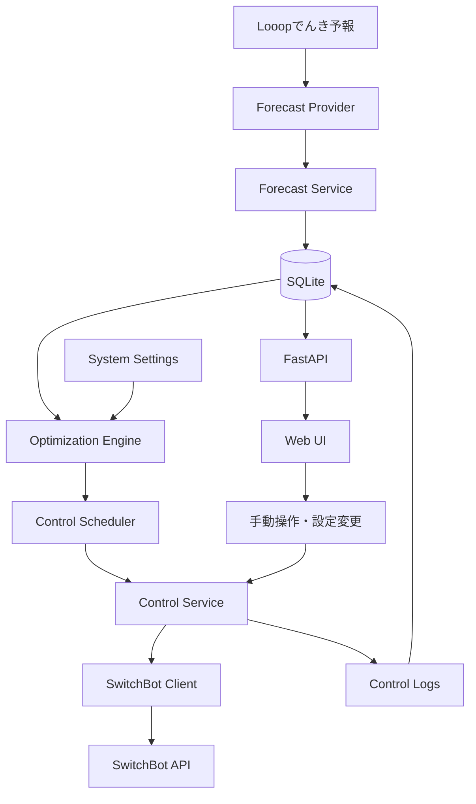

# システム構成

## 3.1 全体アーキテクチャ

## 3.2 コンポーネント

| コンポーネント | 責務 |
|---|---|
| Forecast Provider | 外部料金データの取得 |
| Forecast Service | データ検証・正規化・保存 |
| Optimization Engine | 電力単価に基づく制御計画生成 |
| Control Scheduler | スケジュールの管理・実行 |
| Control Service | 制御要求の受付・排他制御 |
| SwitchBot Client | API通信・状態取得・操作 |
| FastAPI | Web UI・内部APIの提供 |
| SQLite | 料金・設定・予定・履歴の保存 |

自動制御とWeb UIからの手動制御は、共通のControl Serviceを経由させる。
