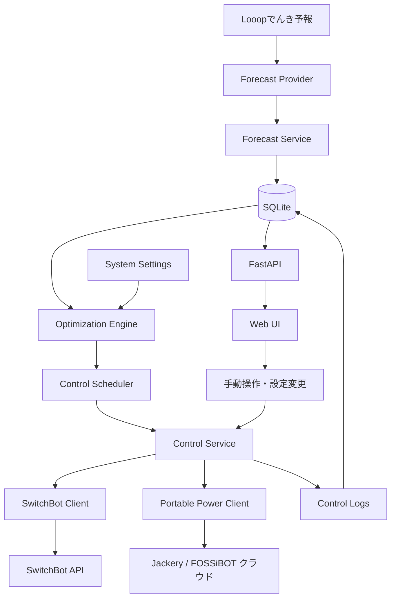

# システム構成

## 3.1 全体アーキテクチャ

## 3.2 コンポーネント

| コンポーネント | 責務 |
|---|---|
| Forecast Provider | 外部料金データの取得 |
| Forecast Service | データ検証・正規化・保存 |
| Optimization Engine | 電力単価に基づく制御計画生成 |
| Control Scheduler | スケジュールの管理・実行 |
| Control Service | 制御要求の受付・排他制御 |
| SwitchBot Client | API通信・機器一覧の取得・状態取得・操作 |
| Portable Power Client | ポータブル電源の機器一覧・残量の取得・充電モードの変更（メーカーごとのクライアントを共通の形にそろえる。docs/17 §17.9.4） |
| FastAPI | Web UI・内部APIの提供 |
| SQLite | 料金・設定・予定・履歴の保存 |

自動制御とWeb UIからの手動制御は、共通のControl Serviceを経由させる。

制御機器（SwitchBot）とポータブル電源は DB（`devices`）に登録して管理し、Control Service は登録された機器ごとに状態の判定・送信・照合を行う（docs/17-multi-device.md）。
