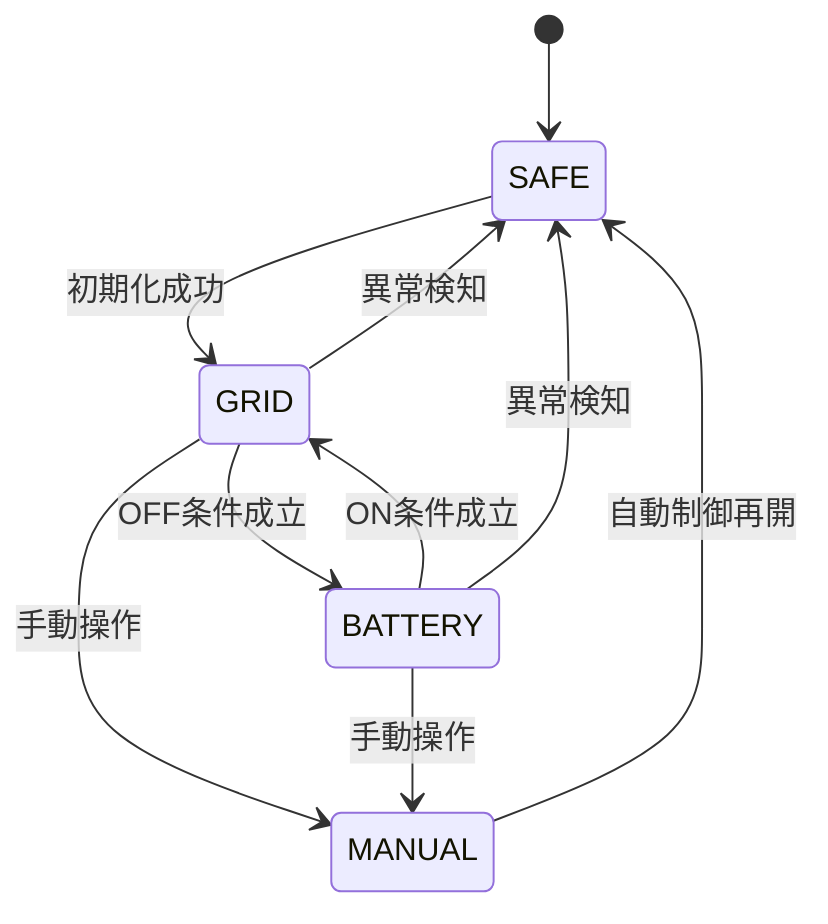

# 制御ロジック

## 7.1 基本方針

制御スケジュール（スマートプラグを OFF にして蓄電池から給電する時間帯）は、Looopでんき でんき予報の区分（docs/06-forecast-provider.md §6.2）に基づいて生成する。独自の価格差計算による最適化は行わない。

| 区分 | 定義（平日。土日祝は過去3日間） | スケジュール |
|---|---|---|
| でんき警報 | JEPX平均価格が100円を超える全コマ | 生成し、常に自動で有効にする |
| でんき注意報 | 過去5日間のJEPX平均より5円以上高い単価のうち、最も高い10コマ | 生成し、`AUTO_ENABLE` が有効なら自動で有効にする |
| でんき日和・区分なし | — | 生成しない（プラグ ON のまま） |

制御の判断にはでんき予報の電源料金単価（電源単価）を用いる。請求単価（電源単価＋加算額）は実際の支払単価の目安として画面に表示するためだけに保持し、制御には使わない。

ポータブル電源（Jackery 1000 New）の残量は Jackery クラウドから取得し、残量が下限を下回ったら ON に戻す（§7.7）。残量を取得できない場合に備え、OFF時間の制限（§7.5）も併用する。

## 7.2 推定節約額

スケジュールごとの推定節約額は、電源単価で算出する。

```text
推定節約額 =
    OFF時間帯に回避できる電力購入費（OFF時間帯の電源単価 × 供給電力量）
    -
    充電に必要な電力購入費（当日の運用時間内の最安の電源単価 × 必要充電電力量）

供給電力量     = 想定平均負荷 × OFF時間
必要充電電力量 = 供給電力量 ÷ 往復効率
```

推定節約額は表示用の目安であり、スケジュールを生成・有効化するかどうかの判断には使わない。

## 7.3 制御状態

| 状態 | 説明 |
|---|---|
| GRID | スマートプラグON |
| BATTERY | スマートプラグOFF |
| SAFE | 安全側への復帰を要求 |
| MANUAL | 手動操作優先（スケジュールは実行しない。安全制御は継続。docs/05 §5.8） |



制御処理はControl Serviceに集約し、Web UIとスケジューラー間の競合を防ぐ。

## 7.4 スケジュールの生成と有効化

1. でんき予報の取得・再取得のたびに、取得した日（当日、16:15以降は翌日も）のスケジュールを生成する。設定画面で制御条件を保存したとき、画面から再生成を指示したときも当日・翌日分を再生成する。予報が未取得の日はスケジュールを生成しない。
2. 注意報・警報のコマが連続する区間を、1つの OFF スケジュールとする。警報と注意報が隣接する区間は区分ごとに分ける。
3. 各スケジュールは「有効（Enabled）」「無効（Disabled）」のいずれかを持ち、有効なスケジュールのみ実行する。

| 区分 | 生成時の状態 |
|---|---|
| でんき警報 | 有効（`AUTO_ENABLE` の設定によらない） |
| でんき注意報 | `AUTO_ENABLE` が有効なら有効、無効なら無効 |

4. 生成時の状態にかかわらず、ユーザーは運転スケジュール画面から個別に有効・無効を切り替えられる（警報のスケジュールを無効にすることも可能）。
5. `AUTO_ENABLE` は設定画面から変更できる（初期値：無効）。変更は以降に生成するスケジュールに適用し、手動で切り替えたスケジュールには影響しない。

### 再生成時の扱い

- 手動で変更（有効・無効の切り替え、時間変更）したスケジュールと、開始済みのスケジュールは、再生成で上書きしない。
- 手動で変更していない未開始のスケジュールは、最新の予報で作り直す。当日の経過済みのコマには新しいスケジュールを作らない。
- 新たに注意報・警報になったコマは、手動で変更したスケジュールと重ならない範囲で新しいスケジュールとして追加する。

## 7.5 OFF時間の制限

| 制限 | 設定値 | でんき注意報 | でんき警報（残量を取得できる間） | でんき警報（残量を取得できない間） |
|---|---|---|---|---|
| 運用時間 | `OPERATION_START` / `OPERATION_END` | 運用時間内に限る | 適用しない | 適用する |
| 最大連続OFF時間 | `MAX_CONTINUOUS_OFF_MINUTES` | 適用する | 適用しない | 適用する |
| 1日の最大OFF時間 | `MAX_DAILY_OFF_MINUTES` | 適用する | 適用しない | 適用する |
| 最低切り替え間隔 | `MIN_SWITCH_INTERVAL_MINUTES` | 適用する | 適用する | 適用する |
| 残量の下限 | `BATTERY_MIN_PERCENT` | 適用する | 適用する | —（判定できない） |

- 注意報のスケジュールが制限を超える場合は、生成時に電源単価の高いコマを優先して制限内に収める。
- 警報は単価が極端に高い時間帯のため、残量を取得できる間は制限を超えてOFFにできる。蓄電池切れは残量の下限（§7.7）で防ぐ。
- 警報のスケジュールは生成時には制限で切り詰めない。実行中に残量を取得できない状態になった場合は、その時点から制限を適用し、制限に達していれば（運用時間外・連続OFF時間の超過・1日のOFF時間の超過）ON に戻す。残量を取得できない状態で警報のスケジュールの開始時刻を迎えた場合も、制限の範囲内でのみOFFにする。
- 1日のOFF時間の合計には、警報のOFF時間も含める。
- 制限は有効なスケジュールの合計で判定する。

## 7.6 手動での時間変更

でんき予報に基づいて生成したスケジュールは、運転スケジュール画面から開始・終了時刻を変更できる。変更は30分単位とし、以下を満たす範囲に限る。

- 他のスケジュールと重ならない。
- 他のスケジュールとの間隔が 0（連続。切り替えが発生しない）か、`MIN_SWITCH_INTERVAL_MINUTES` 以上ある。
- 対象日の範囲内で、開始時刻が現在より後である（開始済みのスケジュールは有効・無効の切り替えも含めて変更できない）。
- 注意報のスケジュールは §7.5 の制限（運用時間・最大連続OFF時間・1日の最大OFF時間）を超えない。警報のスケジュールは制限を受けない。

注意報のスケジュールを有効にする場合は、有効なスケジュールの合計が1日の最大OFF時間を超えないことも確認する。

時間を変更したスケジュールは「手動変更済み」とし、再生成で上書きしない。

## 7.7 ポータブル電源の残量による制御

ポータブル電源の残量（%）と消費電力（出力電力 W）を Jackery クラウドから取得し（docs/08-switchbot-api.md §8.4）、蓄電池切れで給電が止まるのを防ぐ。

### 取得のタイミング

| タイミング | 内容 |
|---|---|
| スケジュールの開始時（OFF にする直前） | 開始してよいかを判定する |
| プラグ OFF（BATTERY）中 | 5分ごとに取得し、OFF を続けてよいかを判定する |
| それ以外 | 取得しない（画面には最後に取得した値と取得日時を表示する） |

### 判定

消費電力がそのまま続いた場合に、**次の取得時（5分後。スケジュールの終了の方が早ければ終了時）**の残量を予測し、下限を下回る直前まで OFF を続ける。

```text
消費電力(W)   = max(今回の出力電力, この OFF 中に取得した出力電力の平均)
1時間あたりの減少(%) = 消費電力 ÷ 放電効率 ÷ 容量(Wh) × 100
予測残量(%)   = 現在の残量 − 1時間あたりの減少 × 次の取得までの時間(h)
```

| 条件 | 対応 |
|---|---|
| 残量が `BATTERY_MIN_PERCENT`（初期値 5%）以下 | OFF 中ならでんき警報のスケジュール中でも ON に戻す（SAFETY として記録）。開始時なら OFF を開始しない |
| 予測残量が `BATTERY_MIN_PERCENT` を下回る | 同上（下回る前に ON に戻す） |
| 残量または消費電力を取得できない（未設定・通信エラー・値が不正・取得から10分超） | 残量による判定は行わず、§7.5 の OFF 時間の制限で保護する。でんき警報のスケジュールにも制限を適用する |

- ON に戻したスケジュールの残り時間は再開しない。
- 消費電力は瞬間値のため、OFF 中の平均と比べて大きい方を使い、予測を安全側に寄せる。開始時はプラグが ON でも出力電力は家電の消費電力を示すため、同じ式で判定できる。
- スケジュール終了までの予測残量（このままの消費電力で下限に達する見込み時刻）は画面に表示するが、判定には上記の「次の取得時」の予測を使う。
- 残り給電時間などの値は機種や AC 入力の有無で実際と一致しないため、表示用の参考値とし、制御には使わない。

| 設定 | 環境変数 | 初期値 |
|---|---|---|
| 残量の下限 | `BATTERY_MIN_PERCENT` | 5% |
| 容量 | `BATTERY_CAPACITY_WH` | 1070Wh（Jackery 1000 New の公称容量） |
| 放電効率 | `BATTERY_DISCHARGE_EFFICIENCY` | 0.85 |

## 7.8 スケジュールの実行（制御サイクル）

Control Service（`app/services/controller.py`）が毎分（各分の5秒）制御サイクルを実行し、有効なスケジュールの間は OFF、それ以外は ON を要求する。状態の変更はすべて Control Service を経由し、制御履歴（control_logs）に記録する。

1. 終了時刻を過ぎたスケジュールを後処理する。実行中だったものは「完了」とし、実行した時間帯の推定節約額を記録する。開始されなかったものは「未実行」とする（無効だった／開始時刻にシステムが停止していた）。
2. 現在時刻を含む有効なスケジュールがあれば、実行時の安全判定（§7.5・§7.7、`app/services/safety.py`）を行う。
   - 判定を通れば OFF を要求する（すでに OFF なら何もしない）。開始時刻を実行開始として記録する。
   - 判定を通らなければ、OFF 中なら ON に戻し（SAFETY）、スケジュールを「中断」とする。開始前なら OFF にせず「中断」とする。
3. 有効なスケジュールがなく OFF 中なら ON に戻す（スケジュール終了）。間隔0で連続するスケジュールの間は ON にしない。
4. MANUAL モードでは 2・3 を行わず、手動 OFF の安全制御（docs/05 §5.8）のみ行う。終了時刻を過ぎたスケジュールは「未実行（自動制御を停止していました）」とする。
5. プラグの状態を確認できない間（初期化前・照合できなかった後）は、ON への初期化のみを要求し、OFF は要求しない。

| 実行状態 | 説明 |
|---|---|
| PENDING（予定） | 未実行 |
| RUNNING（実行中） | OFF を実行中 |
| DONE（完了） | 終了時刻まで実行した |
| ABORTED（中断） | 安全判定で開始できなかった、途中で ON に戻した、またはシステムの終了で中断した |
| SKIPPED（未実行） | 無効だった、または開始時刻にシステムが停止していた |

- 中断・未実行の理由はスケジュールに記録し、運転スケジュール画面に表示する。
- 中断したスケジュールは再開しない。開始済みのスケジュールは変更できない（§7.6）。
- 推定節約額の検証のため、計画時の推定節約額とは別に、実際に OFF にした（Dry Run では OFF にするはずだった）時間帯の推定節約額を記録する。
