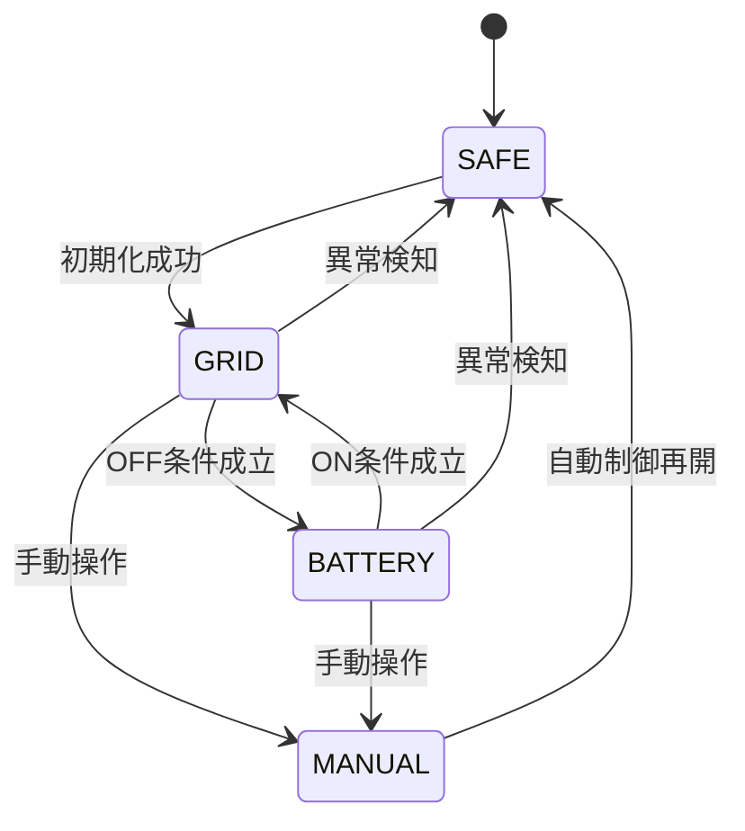

# 制御ロジック

## 7.1 基本方針

単純な価格閾値だけではなく、安価な時間帯と高額な時間帯の価格差に基づいてON/OFF計画を生成する。

考慮する項目：

- 30分単位の予報単価
- 実効電力量単価
- 充放電効率
- 想定平均負荷
- 最低切り替え間隔
- 最大連続OFF時間
- 1日の最大OFF時間
- 運用終了時刻
- 最低節約額

蓄電池の容量や残量を直接取得することは初期リリースの必須条件としない。

残量が不明であることを前提に、OFF時間を保守的に制限する。

## 7.2 経済性判定

```text
推定削減額 =
    高額時間帯に回避できる電力購入費
    -
    充電に必要な電力購入費
    -
    推定充放電コスト
```

充電に必要な電力量：

```text
必要充電電力量 = 供給電力量 ÷ 往復効率
```

実際の比較には、固定従量料金等を考慮した実効電力量単価を使用する。

## 7.3 制御状態

| 状態 | 説明 |
|---|---|
| GRID | スマートプラグON |
| BATTERY | スマートプラグOFF |
| SAFE | 安全側への復帰を要求 |
| MANUAL | 手動操作優先 |



制御処理はControl Serviceに集約し、Web UIとスケジューラー間の競合を防ぐ。
