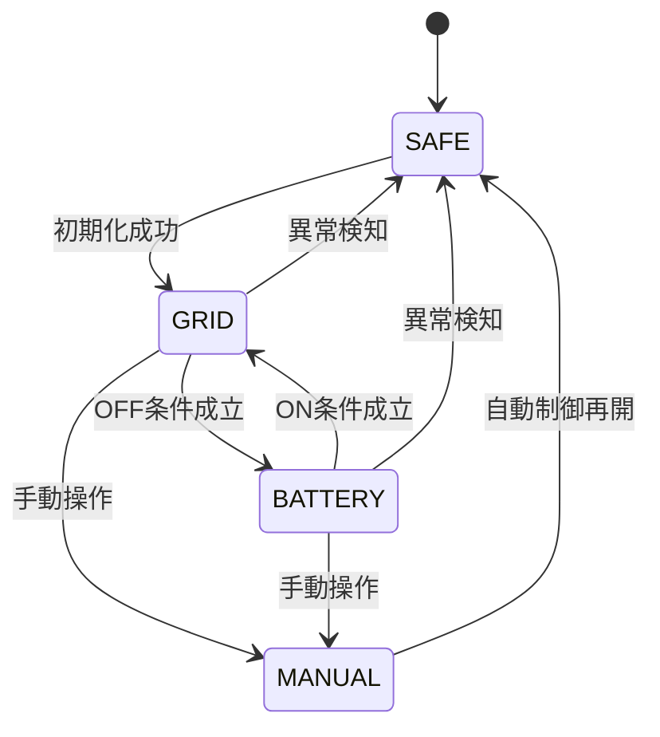

# 制御ロジック

## 7.1 基本方針

制御スケジュール（スマートプラグを OFF にして蓄電池から給電する時間帯）は、Looopでんき でんき予報の区分（docs/06-forecast-provider.md §6.2）に基づいて生成する。独自の価格差計算による最適化は行わない。

| 区分 | 定義（平日。土日祝は過去3日間） | スケジュール |
|---|---|---|
| でんき警報 | JEPX平均価格が100円を超える全コマ | 生成し、常に自動で有効にする |
| でんき注意報 | 過去5日間のJEPX平均より5円以上高い単価のうち、最も高い10コマ | 生成し、`AUTO_ENABLE` が有効なら自動で有効にする |
| でんき日和・区分なし | — | 生成しない（プラグ ON のまま） |

このほか、ユーザーが時間帯と内容（ON／OFF）を指定する任意スケジュールを登録できる（§7.9）。

制御の判断にはでんき予報の電源料金単価（電源単価）を用いる。請求単価（電源単価＋加算額）は実際の支払単価の目安として画面に表示するためだけに保持し、制御には使わない。

ポータブル電源（Jackery 1000 New）の残量は Jackery クラウドから取得し、残量が下限を下回ったら ON に戻す（§7.7）。残量を取得できない場合に備え、OFF時間の制限（§7.5）も併用する。

## 7.2 推定節約額

スケジュールごとの推定節約額は、電源単価で算出する。

```text
推定節約額 =
    OFF時間帯に回避できる電力購入費（OFF時間帯の電源単価 × 供給電力量）
    -
    充電に必要な電力購入費（当日の運用時間内の最安の電源単価 × 必要充電電力量）

供給電力量     = 想定平均負荷 × OFF時間
必要充電電力量 = 供給電力量 ÷ 往復効率
```

推定節約額は表示用の目安であり、スケジュールを生成・有効化するかどうかの判断には使わない。

## 7.3 制御状態

| 状態 | 説明 |
|---|---|
| GRID | スマートプラグON |
| BATTERY | スマートプラグOFF |
| SAFE | 安全側への復帰を要求 |
| MANUAL | 手動操作優先（スケジュールは実行しない。安全制御は継続。docs/05 §5.8） |



制御処理はControl Serviceに集約し、Web UIとスケジューラー間の競合を防ぐ。

## 7.4 スケジュールの生成と有効化

1. でんき予報の取得・再取得のたびに、取得した日（当日、16:15以降は翌日も）のスケジュールを生成する。設定画面で制御条件を保存したとき、画面から再生成を指示したときも当日・翌日分を再生成する。予報が未取得の日はでんき予報のスケジュールを生成しない（任意スケジュールは展開する、§7.9）。
2. 注意報・警報のコマが連続する区間を、1つの OFF スケジュールとする。警報と注意報が隣接する区間は区分ごとに分ける。
3. 各スケジュールは「有効（Enabled）」「無効（Disabled）」のいずれかを持ち、有効なスケジュールのみ実行する。

| 区分 | 生成時の状態 |
|---|---|
| でんき警報 | 有効（`AUTO_ENABLE` の設定によらない） |
| でんき注意報 | `AUTO_ENABLE` が有効なら有効、無効なら無効 |

4. 生成時の状態にかかわらず、ユーザーは運転スケジュール画面から個別に有効・無効を切り替えられる（警報のスケジュールを無効にすることも可能）。
5. `AUTO_ENABLE` は設定画面から変更できる（初期値：無効）。変更は以降に生成するスケジュールに適用し、手動で切り替えたスケジュールには影響しない。

### 再生成時の扱い

- 手動で変更（有効・無効の切り替え、時間変更）したスケジュールと、開始済みのスケジュールは、再生成で上書きしない。
- 手動で変更していない未開始のスケジュールは、最新の予報で作り直す。当日の経過済みのコマには新しいスケジュールを作らない。
- 新たに注意報・警報になったコマは、手動で変更したスケジュールと重ならない範囲で新しいスケジュールとして追加する。

## 7.5 OFF時間の制限

| 制限 | 設定値 | でんき注意報 | でんき警報（残量を取得できる間） | でんき警報（残量を取得できない間） |
|---|---|---|---|---|
| 運用時間 | `OPERATION_START` / `OPERATION_END` | 運用時間内に限る | 適用しない | 適用する |
| 最大連続OFF時間 | `MAX_CONTINUOUS_OFF_MINUTES` | 適用する | 適用しない | 適用する |
| 1日の最大OFF時間 | `MAX_DAILY_OFF_MINUTES` | 適用する | 適用しない | 適用する |
| 最低切り替え間隔 | `MIN_SWITCH_INTERVAL_MINUTES` | 適用する | 適用する | 適用する |
| 残量の下限 | `BATTERY_MIN_PERCENT` | 適用する | 適用する | —（判定できない） |

- 注意報のスケジュールが制限を超える場合は、生成時に電源単価の高いコマを優先して制限内に収める。
- 警報は単価が極端に高い時間帯のため、残量を取得できる間は制限を超えてOFFにできる。蓄電池切れは残量の下限（§7.7）で防ぐ。
- 警報のスケジュールは生成時には制限で切り詰めない。実行中に残量を取得できない状態になった場合は、その時点から制限を適用し、制限に達していれば（運用時間外・連続OFF時間の超過・1日のOFF時間の超過）ON に戻す。残量を取得できない状態で警報のスケジュールの開始時刻を迎えた場合も、制限の範囲内でのみOFFにする。
- 1日のOFF時間の合計には、警報のOFF時間も含める。
- 制限は有効なスケジュールの合計で判定する。

## 7.6 手動での時間変更

でんき予報に基づいて生成したスケジュールは、運転スケジュール画面から開始・終了時刻を変更できる。変更は30分単位とし、以下を満たす範囲に限る。

- 他のスケジュールと重ならない。
- 他のスケジュールとの間隔が 0（連続。切り替えが発生しない）か、`MIN_SWITCH_INTERVAL_MINUTES` 以上ある。
- 対象日の範囲内で、開始時刻が現在より後である（開始済みのスケジュールは有効・無効の切り替えも含めて変更できない）。
- 注意報のスケジュールは §7.5 の制限（運用時間・最大連続OFF時間・1日の最大OFF時間）を超えない。警報のスケジュールは制限を受けない。

注意報のスケジュールを有効にする場合は、有効なスケジュールの合計が1日の最大OFF時間を超えないことも確認する。

時間を変更したスケジュールは「手動変更済み」とし、再生成で上書きしない。

## 7.7 ポータブル電源の残量による制御

ポータブル電源の残量（%）と消費電力（出力電力 W）を Jackery クラウドから取得し（docs/08-switchbot-api.md §8.4）、蓄電池切れで給電が止まるのを防ぐ。

### 取得のタイミング

| タイミング | 内容 |
|---|---|
| スケジュールの開始時（OFF にする直前） | 開始してよいかを判定する |
| プラグ OFF（BATTERY）中 | 5分ごとに取得し、OFF を続けてよいかを判定する |
| それ以外 | 取得しない（画面には最後に取得した値と取得日時を表示する） |

### 判定

消費電力がそのまま続いた場合に、**次の取得時（5分後。スケジュールの終了の方が早ければ終了時）**の残量を予測し、下限を下回る直前まで OFF を続ける。

```text
消費電力(W)   = max(今回の出力電力, この OFF 中に取得した出力電力の平均)
1時間あたりの減少(%) = 消費電力 ÷ 変換効率 ÷ 容量(Wh) × 100
予測残量(%)   = 現在の残量 − 1時間あたりの減少 × 次の取得までの時間(h)
```

| 条件 | 対応 |
|---|---|
| 残量が `BATTERY_MIN_PERCENT`（初期値 5%）以下 | OFF 中ならでんき警報のスケジュール中でも ON に戻す（SAFETY として記録）。開始時なら OFF を開始しない |
| 予測残量が `BATTERY_MIN_PERCENT` を下回る | 同上（下回る前に ON に戻す） |
| 残量または消費電力を取得できない（未設定・通信エラー・値が不正・取得から10分超） | 残量による判定は行わず、§7.5 の OFF 時間の制限で保護する。でんき警報のスケジュールにも制限を適用する |

- ON に戻したスケジュールの残り時間は再開しない。
- 消費電力は瞬間値のため、OFF 中の平均と比べて大きい方を使い、予測を安全側に寄せる。開始時はプラグが ON でも出力電力は家電の消費電力を示すため、同じ式で判定できる。
- スケジュール終了までの予測残量（このままの消費電力で下限に達する見込み時刻）は画面に表示するが、判定には上記の「次の取得時」の予測を使う。
- 残り給電時間などの値は機種や AC 入力の有無で実際と一致しないため、表示用の参考値とし、制御には使わない。

| 設定 | 環境変数 | 初期値 |
|---|---|---|
| 残量の下限 | `BATTERY_MIN_PERCENT` | 5% |
| 容量 | `BATTERY_CAPACITY_WH` | 1070Wh（Jackery 1000 New の公称容量） |
| 変換効率 | `ROUND_TRIP_EFFICIENCY` | 0.85（推定節約額の計算と共用。放電だけの効率より低いため予測は安全側になる） |

## 7.8 スケジュールの実行（制御サイクル）

Control Service（`app/services/controller.py`）が毎分（各分の5秒）制御サイクルを実行し、有効なスケジュールの間は OFF、それ以外は ON を要求する。状態の変更はすべて Control Service を経由し、制御履歴（control_logs）に記録する。

1. 終了時刻を過ぎたスケジュールを後処理する。実行中だったものは「完了」とし、実行した時間帯の推定節約額を記録する。開始されなかったものは「未実行」とする（無効だった／開始時刻にシステムが停止していた）。
2. 現在時刻を含む有効なスケジュールがあれば、実行時の安全判定（§7.5・§7.7、`app/services/safety.py`）を行う。
   - 判定を通れば OFF を要求する（すでに OFF なら何もしない）。開始時刻を実行開始として記録する。
   - 判定を通らなければ、OFF 中なら ON に戻し（SAFETY）、スケジュールを「中断」とする。開始前なら OFF にせず「中断」とする。
3. 有効なスケジュールがなく OFF 中なら ON に戻す（スケジュール終了）。間隔0で連続するスケジュールの間は ON にしない。
4. MANUAL モードでは 2・3 を行わず、手動 OFF の安全制御（docs/05 §5.8）のみ行う。終了時刻を過ぎたスケジュールは「未実行（自動制御を停止していました）」とする。
5. プラグの状態を確認できない間（初期化前・照合できなかった後）は、ON への初期化のみを要求し、OFF は要求しない。

| 実行状態 | 説明 |
|---|---|
| PENDING（予定） | 未実行 |
| RUNNING（実行中） | OFF を実行中（任意 ON のスケジュールは ON を維持中） |
| DONE（完了） | 終了時刻まで実行した |
| ABORTED（中断） | 安全判定で開始できなかった、途中で ON に戻した、またはシステムの終了で中断した |
| SKIPPED（未実行） | 無効だった、または開始時刻にシステムが停止していた |

- 中断・未実行の理由はスケジュールに記録し、運転スケジュール画面に表示する。
- 中断したスケジュールは再開しない。開始済みのスケジュールは変更できない（§7.6）。
- 推定節約額の検証のため、計画時の推定節約額とは別に、実際に OFF にした（Dry Run では OFF にするはずだった）時間帯の推定節約額を記録する。

## 7.9 任意スケジュール

でんき予報とは別に、ユーザーが時間帯と内容（ON／OFF）を指定してスケジュールを登録できる。登録内容は「ルール」（schedule_rules、docs/10 §10.9）として保存し、対象日ごとの control_schedules に展開して実行する。

### 指定できる内容

| 項目 | 内容 |
|---|---|
| 名前 | 画面表示用（例：夕方の在宅時間） |
| 制御内容 | OFF：プラグを OFF にして蓄電池から給電する／ON：プラグを ON に保つ（でんき予報のスケジュールを作らない） |
| 時間帯 | 開始・終了時刻（30分単位。対象日の範囲内、日付をまたがない） |
| 繰り返し | 1回のみ（対象日を指定）／毎日／曜日指定（月〜日から複数選択。祝日は区別しない） |
| 有効・無効 | ルール単位で切り替える。無効なルールは展開しない |

### 登録時の検証

- 開始時刻が終了時刻より前である。1回のみのルールは、開始時刻が現在より後である。
- 同じ日に適用される他の任意スケジュールと重ならない。OFF 同士の間隔は 0（連続）か `MIN_SWITCH_INTERVAL_MINUTES` 以上ある。
- OFF のルールには、でんき注意報と同じ制限（§7.5）を適用する：運用時間内に限る、`MAX_CONTINUOUS_OFF_MINUTES` 以下、同じ日に適用される任意 OFF の合計が `MAX_DAILY_OFF_MINUTES` 以下。残量の下限（§7.7）も実行時に適用する。
- ON のルールは安全側の制御のため、OFF 時間の制限を受けない。

### 展開

- 当日・翌日分を、起動時・毎日16:15・スケジュールの再生成時・ルールの保存（追加・変更・有効／無効・削除）時に展開する。でんき予報の取得状況によらず展開する（ユーザーが指定した時間帯であり、予報データに依存しないため）。
- 展開したスケジュールは `source_level=CUSTOM`、`rule_id` 付きで保存し、有効（`enabled_by=AUTO`）とする。
- 展開時点の設定で OFF 時間の制限を超える場合（ルール登録後に設定を変更した場合など）は、無効として展開し、理由（制限超過）を表示する。

### でんき予報のスケジュールとの関係

- 任意スケジュールを優先する。でんき予報のスケジュール（§7.4）は、任意スケジュール（ON・OFF とも）と重ならない範囲で生成する。でんき警報のコマも、任意 ON の時間帯には OFF スケジュールを作らない。
- 1日の最大OFF時間は、任意 OFF を先に計上し、残りの範囲で注意報のスケジュールを制限内に収める（電源単価の高いコマを優先）。
- ルールの保存時、当日・翌日の開始済みのスケジュール、または手動変更済みのでんき予報のスケジュールと重なる（OFF 同士で間隔が最低切り替え間隔未満になる場合を含む）場合は、その日には展開せず、保存時の画面に重なる日と時間帯を表示する。手動変更していない未開始のでんき予報のスケジュールは、任意スケジュールを避けて作り直す。

### 変更・削除

- ルールの変更・無効化は、当日・翌日の未開始かつ手動変更していないスケジュールに反映する（作り直し・削除）。開始済みのスケジュールはそのまま残す。
- ルールの削除では、当日・翌日の未開始のスケジュールを手動変更済みのものも含めて削除する。開始済みのものは残し、ルールとの関連（`rule_id`）を外す。
- 展開したスケジュールは、運転スケジュール画面で個別に有効・無効を切り替えられる（「今日だけ実行しない」など。手動変更済みとなり、ルールの変更で上書きしない）。時間の変更はルールで行い、個別には変更しない。

### 実行

- 任意 OFF は、でんき注意報のスケジュールと同じく §7.8 の制御サイクルで実行する（実行時の安全判定・残量の判定を含む）。
- 任意 ON の間は OFF を要求しない（OFF 中なら ON に戻す）。実行状態は ON を維持している間を RUNNING（実行中）とする。
- MANUAL モード中はどちらも実行しない（§7.8 の4）。
- 推定節約額は、任意 OFF について §7.2 の式で算出する（予報が未取得の時間帯は算出しない）。任意 ON は算出しない。

## 7.10 ポータブル電源の充電モード

ポータブル電源（Jackery）の充電モード（高速充電／静かな充電）をスケジュールに合わせて切り替える。超急速充電は扱わない。充電モードは電源の供給に影響しないため、変更の失敗はプラグの制御に影響させない。

- スケジュールごとに開始時・終了時の充電モード（静かな充電／高速充電／変更しない）を持ち、開始時・終了時にその設定へ切り替える。でんき予報のスケジュール・任意スケジュール（ON／OFF とも）を対象とする。「変更しない」は送信しない。
- 設定の既定値：でんき予報のスケジュールは設定画面の既定値（`CHARGE_MODE_START` / `CHARGE_MODE_END`、初期値は開始時に静かな充電・終了時に高速充電）で生成し、任意スケジュールはルールごとの値で展開する。既定値・ルールの変更は、手動で変更していない開始前のスケジュールに再生成で反映する。
- 運転スケジュール画面から個別に変更できる（手動変更済みとし、再生成で上書きしない）。開始時は開始前のみ、終了時は終了前（実行中を含む）のみ変更できる。
- 判定は実行中（RUNNING）になった・実行中でなくなったスケジュールで行う。中断（安全制御・手動操作・自動制御の停止・システムの終了）も終了として扱い、終了時の設定に切り替える。開始できなかった（実行中にならなかった）スケジュールでは切り替えない。
- 同じ制御サイクルで終了と開始が重なる場合（連続するスケジュール）は、開始するスケジュールの開始時の設定を優先し（「変更しない」の場合は終了するスケジュールの終了時の設定）、送信は1回にする。すでにそのモードなら送らない。
- 切り替えの対象とした実行中のスケジュールを DB（`system_settings` の `charge_mode_running_schedules`）に保持し、実行中に停止して終了後に再起動した場合も終了時の設定に切り替える。
- ダッシュボードから手動で変更できる。手動の変更は MANUAL モードへの移行を伴わず、次のスケジュールの開始・終了時には上記のとおり切り替える。
- 変更は Control Service を経由し、変更後に再取得して照合する（docs/08-switchbot-api.md §8.4）。自動の変更に失敗した場合は異常表示し、5分ごとに再試行する（同じ失敗は記録し直さない）。
- Dry Run 中はプラグと同じく送信せず、変更の予定を記録し、画面には想定のモードを表示する。
- 変更の記録は `system_events`（カテゴリ `CHARGE_MODE`）に残す。成功・Dry Run の記録は解決済みとし、失敗のみ未解決として表示する（次の成功で解決）。
