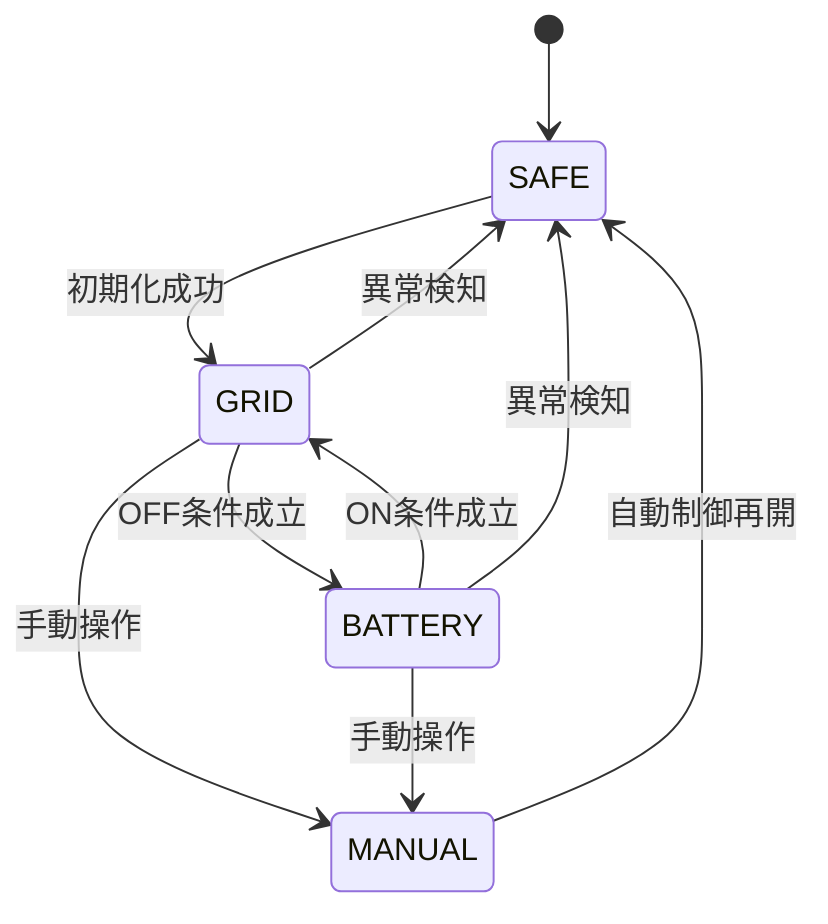

# 制御ロジック

## 7.1 基本方針

制御スケジュール（スマートプラグを OFF にして蓄電池から給電する時間帯）は、Looopでんき でんき予報の区分（docs/06-forecast-provider.md §6.2）に基づいて生成する。独自の価格差計算による最適化は行わない。

| 区分 | 定義（平日。土日祝は過去3日間） | スケジュール |
|---|---|---|
| でんき警報 | JEPX平均価格が100円を超える全コマ | 生成し、常に自動で有効にする |
| でんき注意報 | 過去5日間のJEPX平均より5円以上高い単価のうち、最も高い10コマ | 生成し、`AUTO_ENABLE` が有効なら自動で有効にする |
| でんき日和・区分なし | — | 生成しない（プラグ ON のまま） |

制御の判断にはでんき予報の電源料金単価（電源単価）を用いる。請求単価（電源単価＋加算額）は実際の支払単価の目安として画面に表示するためだけに保持し、制御には使わない。

ポータブル電源（Jackery 1000 New）の残量は Jackery クラウドから取得し、残量が下限を下回ったら ON に戻す（§7.7）。残量を取得できない場合に備え、OFF時間の制限（§7.5）も併用する。

## 7.2 推定節約額

スケジュールごとの推定節約額は、電源単価で算出する。

```text
推定節約額 =
    OFF時間帯に回避できる電力購入費（OFF時間帯の電源単価 × 供給電力量）
    -
    充電に必要な電力購入費（当日の運用時間内の最安の電源単価 × 必要充電電力量）

供給電力量     = 想定平均負荷 × OFF時間
必要充電電力量 = 供給電力量 ÷ 往復効率
```

推定節約額は表示用の目安であり、スケジュールを生成・有効化するかどうかの判断には使わない。

## 7.3 制御状態

| 状態 | 説明 |
|---|---|
| GRID | スマートプラグON |
| BATTERY | スマートプラグOFF |
| SAFE | 安全側への復帰を要求 |
| MANUAL | 手動操作優先 |



制御処理はControl Serviceに集約し、Web UIとスケジューラー間の競合を防ぐ。

## 7.4 スケジュールの生成と有効化

1. でんき予報の取得・再取得のたびに、当日（16:15以降は翌日も）のスケジュールを生成する。
2. 注意報・警報のコマが連続する区間を、1つの OFF スケジュールとする。警報と注意報が隣接する区間は区分ごとに分ける。
3. 各スケジュールは「有効（Enabled）」「無効（Disabled）」のいずれかを持ち、有効なスケジュールのみ実行する。

| 区分 | 生成時の状態 |
|---|---|
| でんき警報 | 有効（`AUTO_ENABLE` の設定によらない） |
| でんき注意報 | `AUTO_ENABLE` が有効なら有効、無効なら無効 |

4. 生成時の状態にかかわらず、ユーザーは運転スケジュール画面から個別に有効・無効を切り替えられる（警報のスケジュールを無効にすることも可能）。
5. `AUTO_ENABLE` は設定画面から変更できる（初期値：無効）。変更は以降に生成するスケジュールに適用し、手動で切り替えたスケジュールには影響しない。

### 再生成時の扱い

- 手動で変更（有効・無効の切り替え、時間変更）したスケジュールは、再生成で上書きしない。
- 手動で変更していないスケジュールは、最新の予報で作り直す。
- 新たに注意報・警報になったコマは、手動で変更したスケジュールと重ならない範囲で新しいスケジュールとして追加する。

## 7.5 OFF時間の制限

| 制限 | 設定値 | でんき注意報 | でんき警報（残量を取得できる間） | でんき警報（残量を取得できない間） |
|---|---|---|---|---|
| 運用時間 | `OPERATION_START` / `OPERATION_END` | 運用時間内に限る | 適用しない | 適用する |
| 最大連続OFF時間 | `MAX_CONTINUOUS_OFF_MINUTES` | 適用する | 適用しない | 適用する |
| 1日の最大OFF時間 | `MAX_DAILY_OFF_MINUTES` | 適用する | 適用しない | 適用する |
| 最低切り替え間隔 | `MIN_SWITCH_INTERVAL_MINUTES` | 適用する | 適用する | 適用する |
| 残量の下限 | `BATTERY_MIN_PERCENT` | 適用する | 適用する | —（判定できない） |

- 注意報のスケジュールが制限を超える場合は、生成時に電源単価の高いコマを優先して制限内に収める。
- 警報は単価が極端に高い時間帯のため、残量を取得できる間は制限を超えてOFFにできる。蓄電池切れは残量の下限（§7.7）で防ぐ。
- 警報のスケジュールは生成時には制限で切り詰めない。実行中に残量を取得できない状態になった場合は、その時点から制限を適用し、制限に達していれば（運用時間外・連続OFF時間の超過・1日のOFF時間の超過）ON に戻す。残量を取得できない状態で警報のスケジュールの開始時刻を迎えた場合も、制限の範囲内でのみOFFにする。
- 1日のOFF時間の合計には、警報のOFF時間も含める。
- 制限は有効なスケジュールの合計で判定する。

## 7.6 手動での時間変更

でんき予報に基づいて生成したスケジュールは、運転スケジュール画面から開始・終了時刻を変更できる。変更は30分単位とし、以下を満たす範囲に限る。

- 他のスケジュールと重ならない。
- 他のスケジュールとの間隔が `MIN_SWITCH_INTERVAL_MINUTES` 以上ある。
- 対象日の範囲内である。
- 注意報のスケジュールは §7.5 の制限（運用時間・最大連続OFF時間・1日の最大OFF時間）を超えない。警報のスケジュールは制限を受けない。

時間を変更したスケジュールは「手動変更済み」とし、再生成で上書きしない。

## 7.7 ポータブル電源の残量による制御

ポータブル電源の残量（%）を Jackery クラウドから取得し（docs/08-switchbot-api.md §8.4）、蓄電池切れで給電が止まるのを防ぐ。

| 条件 | 対応 |
|---|---|
| OFF（BATTERY）中に残量が `BATTERY_MIN_PERCENT`（初期値 5%）以下になった | 有効なスケジュール中（でんき警報を含む）でも ON に戻す（SAFETY として記録）。そのスケジュールの残り時間は再開しない |
| 残量が `BATTERY_MIN_PERCENT` 以下 | 新しい OFF を開始しない |
| 残量を取得できない（未設定・通信エラー・値が不正・取得から10分超） | 残量による制御は行わず、§7.5 の OFF 時間の制限で保護する。でんき警報のスケジュールにも制限を適用する |

- 残量はプラグ OFF 中は2分ごと、それ以外は5分ごとに取得する（1%あたり約10.7Wh。150W 程度の負荷では約4分で1%減る）。
- 残量の判定には直近に取得できた値を使い、取得から10分を超えた値は「取得できない」として扱う。
- 残り給電時間などの値は機種や AC 入力の有無で実際と一致しないため、表示用の参考値とし、制御には使わない。
